<p align="center">
  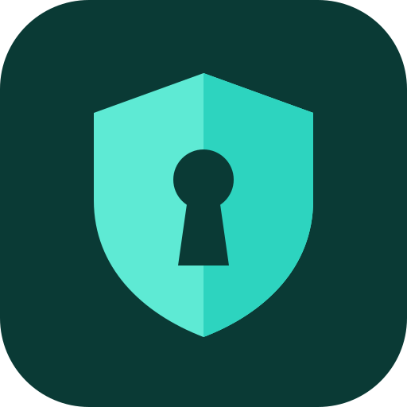
</p>

<h1 align="center">Locksy</h1>

<p align="center">
  Gestionnaire de mots de passe d'entreprise, chiffré de bout en bout, à héberger chez vous.<br>
  Serveur Rust · interface web · client Windows · extension Edge/Chrome · Active Directory sur site.
</p>

---

**Le serveur ne voit jamais un mot de passe en clair.** Tout est chiffré et déchiffré sur le poste
de l'utilisateur (navigateur, client Windows ou extension), avec le même noyau cryptographique
écrit en Rust. Une fuite complète de la base ne livre que des données chiffrées.

<p align="center">
  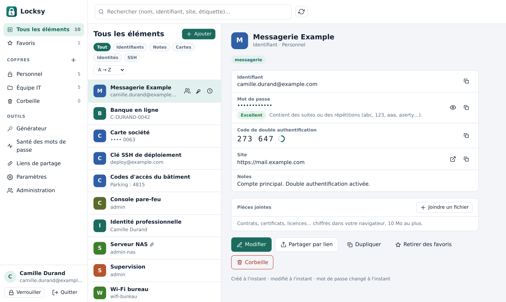
</p>

## Aperçu

<table>
  <tr>
    <td width="50%">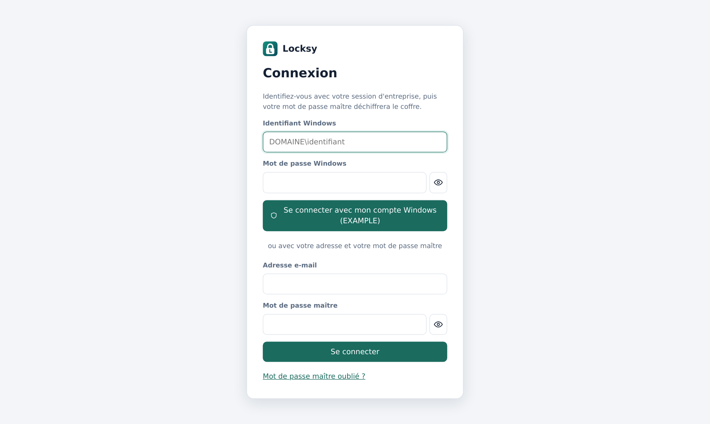<br><sub><b>Connexion</b> avec le compte Windows (Active Directory), puis le mot de passe maître</sub></td>
    <td width="50%">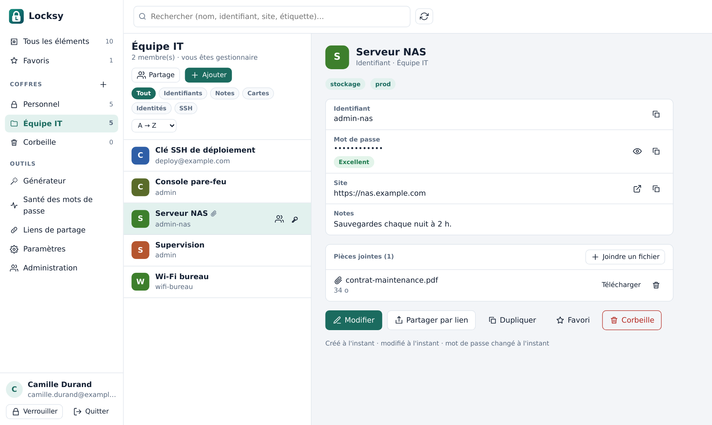<br><sub><b>Coffre partagé</b> d'équipe, pièce jointe chiffrée, copie en un clic</sub></td>
  </tr>
  <tr>
    <td>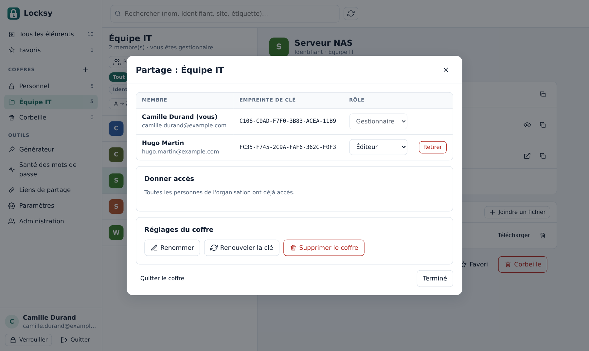<br><sub><b>Partage</b> : rôles, empreintes de clé, renouvellement de clé au retrait</sub></td>
    <td>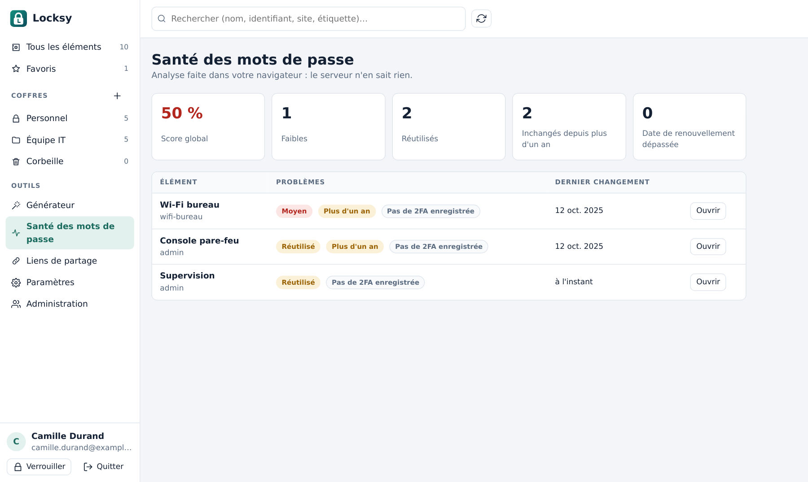<br><sub><b>Santé des mots de passe</b>, calculée sur le poste</sub></td>
  </tr>
  <tr>
    <td>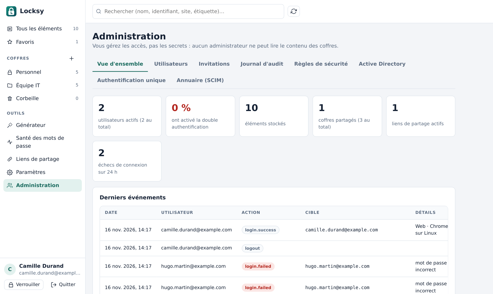<br><sub><b>Administration</b> : vue d'ensemble et derniers événements</sub></td>
    <td>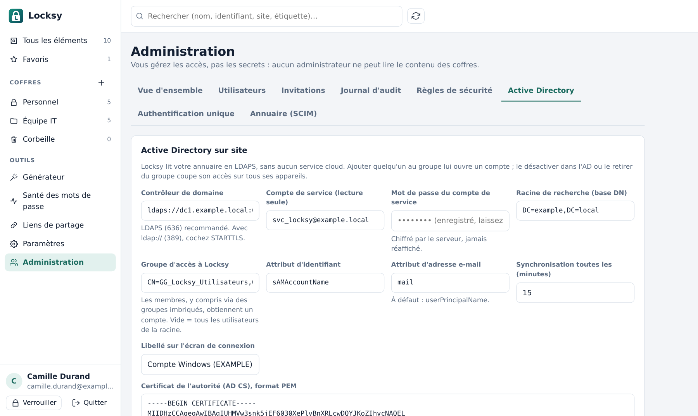<br><sub><b>Active Directory</b> sur site, en LDAPS</sub></td>
  </tr>
  <tr>
    <td>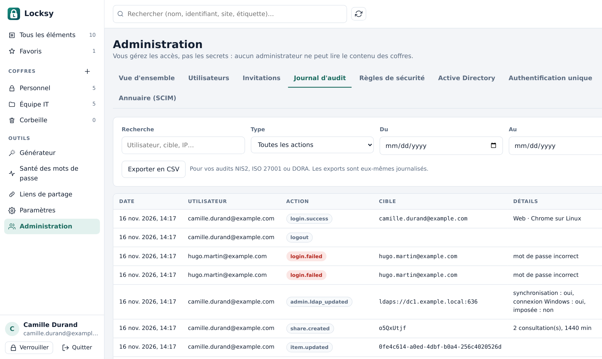<br><sub><b>Journal d'audit</b> filtrable, export CSV et Syslog</sub></td>
    <td>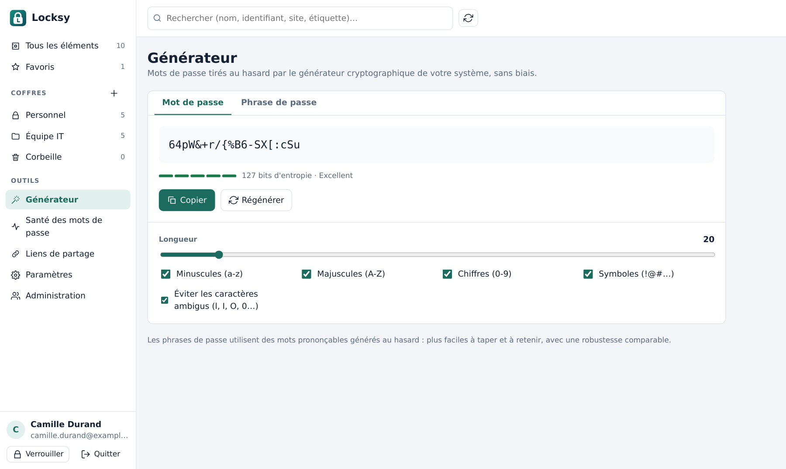<br><sub><b>Générateur</b> de mots de passe et de phrases de passe</sub></td>
  </tr>
  <tr>
    <td>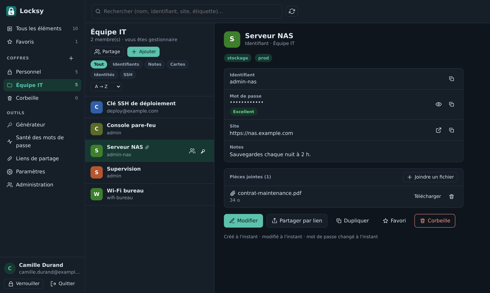<br><sub><b>Thème sombre</b> automatique</sub></td>
    <td align="center">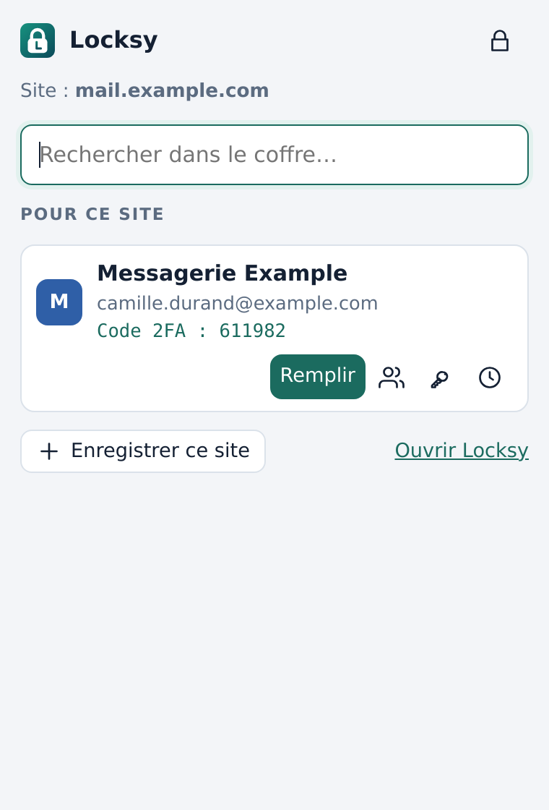<br><sub><b>Extension</b> Edge / Chrome : remplissage protégé contre l'hameçonnage</sub></td>
  </tr>
</table>

<sub>Captures réalisées sur un serveur de démonstration, avec des données fictives.</sub>

## Points forts

- **Chiffrement** : Argon2id (64 Mio), XChaCha20-Poly1305, X25519, HKDF-SHA256 ; chaque donnée
  chiffrée est liée à sa place (le serveur ne peut ni la déplacer ni l'échanger).
- **Coffres partagés** avec rôles (gestionnaire, éditeur, lecteur) ; retirer quelqu'un renouvelle
  la clé du coffre et rechiffre tout son contenu.
- **Active Directory sur site** (LDAPS) : synchronisation d'un groupe, connexion avec le compte
  Windows, **coupure immédiate** d'un compte désactivé dans l'AD. Aucun service cloud requis.
- **SSO OpenID Connect** (ADFS, Entra ID, Okta, Keycloak…) et **provisionnement SCIM 2.0**.
- Identifiants, notes, cartes, identités, clés SSH, **codes 2FA intégrés**, **pièces jointes
  chiffrées**, historique des mots de passe, corbeille, générateur, santé des mots de passe.
- **Liens de partage externes** à usage limité, chiffrés de bout en bout.
- **Administration** sans accès aux secrets : comptes, invitations, double authentification
  imposable, journal d'audit complet (export CSV, envoi Syslog vers votre SIEM).
- **Client Windows** natif et **extension** de navigateur avec remplissage des formulaires.

## Installation du serveur

Sur une VM Linux (Debian, Ubuntu, RHEL…), en une commande :

```bash
curl -fsSL https://github.com/0x80070006/locksy/releases/latest/download/install.sh | sudo bash
```

Le script propose deux modes : **service systemd** (sans Docker) ou **conteneur Docker**. Il
installe un certificat temporaire ou le vôtre (`--cert`, `--key`), démarre Locksy en HTTPS et
vérifie qu'il répond. Pour un réseau isolé, copiez `install.sh` et
`locksy-server-linux-x86_64.tar.gz` depuis la [dernière version](https://github.com/0x80070006/locksy/releases/latest) :

```bash
sudo bash install.sh --archive locksy-server-linux-x86_64.tar.gz --domain locksy.corp.local \
  --cert locksy.crt --key locksy.key
```

Ouvrez ensuite `https://locksy.corp.local` : **le premier compte créé devient propriétaire.**

Pour essayer sur un poste avec Docker Desktop : `docker compose up -d --build`, puis
<http://localhost:8743>.

## Postes de travail

| Composant | Fichier de la version | Installation |
|---|---|---|
| Client Windows | `locksy-windows-x64.exe` + `install-client.ps1` | `powershell -ExecutionPolicy Bypass -File install-client.ps1 -Server https://locksy.corp.local`, ou par GPO |
| Extension Edge / Chrome | `locksy-extension.zip` | mode développeur > « Charger l'extension non empaquetée », ou installation forcée par GPO |
| Interface web | — | tout navigateur récent ; installable comme application |

## Documentation

Tout est dans le dossier **[docs](docs/README.md)** :

- [Installation du serveur](docs/Installation-du-serveur.md) · [Déploiement sur site avec Active Directory](docs/Deploiement-Active-Directory.md)
- [Chiffrement et modèle de sécurité](docs/Chiffrement-et-securite.md)
- [Fonctionnalités](docs/Fonctionnalites.md) · [Administration](docs/Administration.md) · [Client Windows](docs/Client-Windows.md) · [Extension](docs/Extension-navigateur.md)
- [SSO et SCIM](docs/SSO-et-SCIM.md) · [Sauvegarde et mises à jour](docs/Sauvegarde-et-mises-a-jour.md) · [API](docs/API.md) · [Développement](docs/Developpement.md) · [FAQ](docs/FAQ.md)

## Construire depuis les sources

```bash
docker build -f Dockerfile.release --target export --output type=local,dest=dist/release .
```

Produit le serveur Linux autonome, le module WebAssembly et le client Windows ; les tests
s'exécutent pendant la construction. Détails : [Développement](docs/Developpement.md).

## Sécurité

Modèle cryptographique détaillé : [Chiffrement et sécurité](docs/Chiffrement-et-securite.md) et [SECURITE.md](SECURITE.md). Pour signaler une
vulnérabilité, voir [SECURITY.md](SECURITY.md). Locksy n'a pas encore fait l'objet d'un audit
externe.

## Licence

[MIT](LICENSE)
