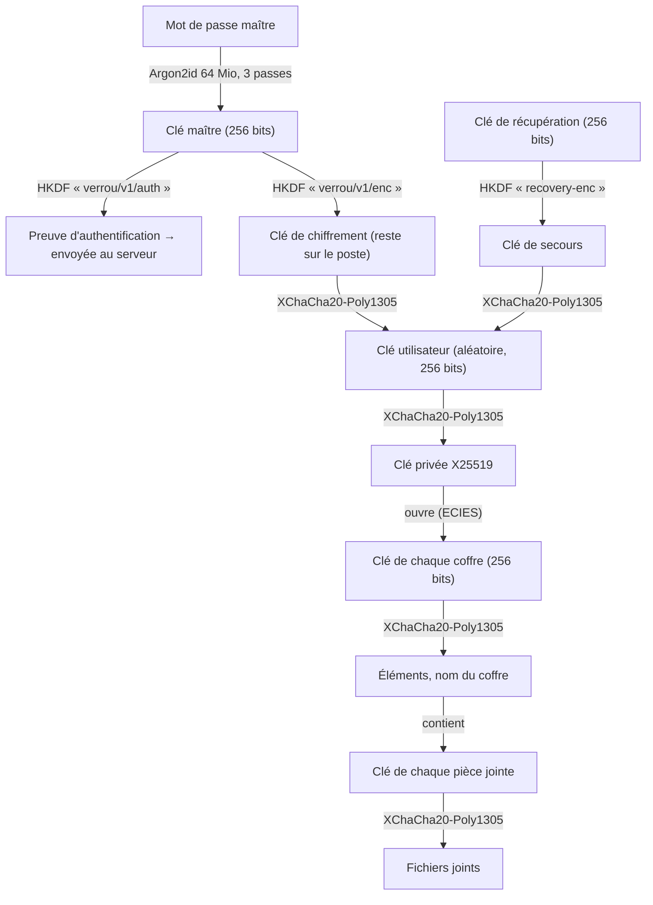

# Chiffrement et modèle de sécurité

Locksy applique un **chiffrement de bout en bout** (« zero-knowledge ») : les mots de passe, notes,
pièces jointes et noms de coffres sont chiffrés et déchiffrés **sur le poste de l'utilisateur**.
Le serveur ne stocke que des données chiffrées, des empreintes Argon2id et des métadonnées
(dates, rôles, appartenance aux coffres).

Le même noyau Rust (`crates/locksy-core`) est utilisé partout :

| Client | Exécution du noyau |
|---|---|
| Interface web | compilé en **WebAssembly** (`locksy.wasm`) |
| Extension Edge / Chrome | même module WebAssembly |
| Client Windows | compilé nativement dans `locksy.exe` |
| Serveur | vérifications de format, TOTP, hachage des preuves (jamais de déchiffrement des coffres) |

Bibliothèques : RustCrypto (`argon2`, `chacha20poly1305`, `hkdf`, `sha2`, `hmac`) et
`x25519-dalek`. Aucun code `unsafe` dans le noyau.

---

## 1. Primitives

| Usage | Algorithme | Paramètres |
|---|---|---|
| Mot de passe maître → clé | **Argon2id** (v1.3) | 64 Mio, 3 passes, 1 voie, sel aléatoire de 128 bits, sortie 256 bits |
| Séparation des clés | **HKDF-SHA256** | sel fixe de domaine, libellés distincts par usage |
| Chiffrement symétrique | **XChaCha20-Poly1305** (AEAD) | clé 256 bits, nonce aléatoire **192 bits**, données associées obligatoires |
| Échange de clés | **X25519** | clé éphémère par scellement, contrôle « contributory » |
| Preuve côté serveur | Argon2id | 19 Mio, 2 passes (sur une preuve déjà issue d'Argon2id) |
| Double authentification | TOTP RFC 6238 | HMAC-SHA1, 6 chiffres, 30 s, ±1 pas, rejeu interdit |
| Jetons (sessions, invitations, liens) | aléa système | 256 bits, stockés **hachés** (SHA-256) |
| Empreinte de clé publique | SHA-256 | 96 premiers bits, en groupes hexadécimaux |

Le mot de passe maître est normalisé en **Unicode NFC** avant dérivation : le même mot de passe
tapé sur Windows, macOS ou un téléphone donne toujours la même clé.

Paramètres Argon2id stockés avec chaque compte : ils pourront être renforcés plus tard sans
casser les comptes existants. Le serveur refuse des paramètres trop faibles (mémoire < 19 Mio,
moins de 2 passes, sel < 128 bits).

## 2. Hiérarchie des clés

Conséquences :
- **Changer de mot de passe maître** ne rechiffre que la clé utilisateur : c'est instantané.
- La **preuve d'authentification** ne permet de rien déchiffrer : elle est issue de la clé
  maître par une branche HKDF séparée, et le serveur la hache encore avec Argon2id.
- Un coffre partagé a **sa propre clé**, scellée séparément pour chaque membre.

## 3. Format des données chiffrées

| Préfixe | Contenu (base64url sans remplissage) |
|---|---|
| `v1.` | `nonce (24 o) ‖ chiffré ‖ étiquette Poly1305 (16 o)` |
| `s1.` | `clé publique éphémère (32 o) ‖ nonce (24 o) ‖ chiffré ‖ étiquette (16 o)` |

### Données associées (liaison au contexte)

Chaque chiffré est lié à **sa place** par ses données associées. Un serveur malveillant ne
peut pas déplacer un élément dans un autre coffre, échanger deux éléments, ni présenter la clé
d'un coffre à un autre membre : le déchiffrement échouerait.

| Donnée | Données associées |
|---|---|
| Clé utilisateur (mot de passe) | `verrou:v1:user-key` |
| Clé utilisateur (récupération) | `verrou:v1:recovery-user-key` |
| Clé privée | `verrou:v1:private-key:{utilisateur}` |
| Nom d'un coffre | `verrou:v1:collection-name:{coffre}` |
| Élément | `verrou:v1:item:{coffre}:{élément}` |
| Clé de coffre scellée | `verrou:v1:collection-key:{coffre}:{membre}` |
| Pièce jointe | `verrou:v1:attachment:{pièce}` |
| Lien de partage | `verrou:v1:share` |
| Sauvegarde chiffrée | `verrou:v1:export` |

> **Pourquoi « verrou » ?** Ces chaînes sont des **identifiants de protocole**, fixés lors de la
> première version (nom de code du projet). Les changer rendrait illisibles tous les coffres
> existants ; elles restent donc identiques, comme les libellés HKDF `verrou/v1/…`.

### Scellement d'une clé de coffre (ECIES)

1. Génération d'une paire X25519 éphémère.
2. Secret partagé avec la clé publique du destinataire ; refus si le secret n'est pas
   « contributory » (clé publique faible).
3. `HKDF-SHA256(sel = clé_éphémère ‖ clé_destinataire, info = "verrou/v1/seal|" + contexte)`.
4. XChaCha20-Poly1305 avec le contexte comme données associées.

## 4. Les parcours

### Création de compte
1. Le navigateur tire un sel, dérive la clé maître (Argon2id), puis la preuve et la clé de
   chiffrement.
2. Il génère la clé utilisateur, la clé de récupération, la paire X25519, le coffre personnel
   et sa clé.
3. Il envoie : la preuve, les clés chiffrées, la clé publique, le coffre personnel chiffré.
4. Le serveur hache la preuve (Argon2id) et enregistre le tout. Il n'a jamais vu le mot de
   passe, ni la clé utilisateur, ni la clé de récupération.

Le **tout premier compte** (propriétaire) exige en plus le jeton d'installation à usage unique
généré par le serveur (`<données>/setup-token`, ou `LOCKSY_SETUP_TOKEN`) : sans lui, la première
personne à joindre un serveur fraîchement installé en prendrait le contrôle. Le serveur n'en
garde que l'empreinte SHA-256 et l'efface, fichier compris, dès la création du compte.

### Connexion
1. `prelogin` : le serveur renvoie les paramètres Argon2id du compte. Pour une adresse
   inconnue, il renvoie des paramètres **factices mais stables** (sel = HMAC-SHA256 avec la clé
   du serveur), pour qu'on ne puisse pas deviner quels comptes existent.
2. Le poste dérive la preuve et l'envoie. Le serveur la vérifie (temps constant, empreinte
   factice pour les comptes inexistants) et, si besoin, demande le code TOTP.
3. Le serveur renvoie la clé utilisateur chiffrée. Le poste la déchiffre localement, puis la clé
   privée. Il vérifie que la clé publique annoncée par le serveur correspond à sa clé privée
   (code client `key_mismatch` sinon).

**Épinglage des paramètres de dérivation (anti-rétrogradation).** Chaque client mémorise, par
adresse e-mail, les paramètres Argon2id les plus forts déjà utilisés avec succès sur cet
appareil (web et extension : `localStorage` `locksy.kdfpins` ; client Windows : `kdf_pins`
dans `%APPDATA%\Locksy\bureau.json`). Si le serveur annonce ensuite un autre algorithme, moins
de mémoire ou moins de passes — au `prelogin`, après SSO ou compte Windows, ou au
déverrouillage — la connexion est refusée **avant tout calcul** et rien n'est envoyé (code
client `kdf_downgrade`). Un serveur compromis ne peut donc pas abaisser le coût d'une attaque
par dictionnaire sur la preuve d'authentification. Un changement de mot de passe ou une
récupération, faits par ce client, remplacent la référence. Stockage indisponible : épinglage
inactif ; effacer les données du site le réinitialise.

### Partage d'un coffre
Le gestionnaire scelle la clé du coffre avec la clé publique du nouveau membre. L'interface
affiche l'**empreinte** de cette clé publique, à comparer de vive voix pour un partage sensible
(protection contre un serveur qui substituerait une clé).

**Épinglage des clés publiques.** L'interface web mémorise la clé publique de chaque membre à
la première rencontre (`localStorage` `locksy.keypins`, par identifiant). Avant chaque
scellement d'une clé de coffre (ajout, retrait, renouvellement), la liste des destinataires
s'affiche avec nom, e-mail, empreinte et état : **nouveau**, **inchangé** ou **CHANGÉ**. Une clé
changée exige de cocher « J'ai vérifié les nouvelles empreintes de vive voix » avant de
confirmer. Notre propre clé est recalculée depuis la clé privée, jamais reprise du serveur. Le
serveur refuse (409) un renouvellement si la liste des membres a changé depuis la
confirmation.

### Retrait d'un membre
Le gestionnaire génère une **nouvelle clé de coffre**, rechiffre le nom et **tous** les
éléments (corbeille comprise), et la scelle pour les membres restants. Le serveur applique tout
en une transaction et refuse si la liste des membres ou des éléments ne correspond pas
exactement. Une copie de l'ancienne clé ne sert plus à rien. Les pièces jointes ne sont pas
rechiffrées : leurs clés sont dans les éléments, rechiffrés, et le serveur n'en sert le contenu
qu'aux membres actuels.

### Pièces jointes
Chaque fichier est chiffré avec une **clé aléatoire propre**, rangée dans l'élément chiffré
(avec le nom et le type du fichier). Le serveur ne voit qu'un bloc chiffré et sa taille.

### Liens de partage externes
Le contenu choisi est chiffré avec une clé aléatoire placée **après le `#`** du lien : les
navigateurs ne l'envoient jamais au serveur. Le serveur limite la durée de vie et le nombre de
consultations, puis détruit le lien. La page publique demande un clic avant d'afficher le
secret (les aperçus automatiques des messageries ne consomment pas de consultation).

### Clé de récupération
256 bits + un octet de contrôle (premier octet de SHA-256), en base32 Crockford par groupes de
4 caractères ; les confusions O/0 et I/L/1 sont corrigées. Elle chiffre une copie de la clé
utilisateur et permet de choisir un nouveau mot de passe maître. Elle est régénérable.

### SSO et compte Windows
OpenID Connect ou Active Directory **prouvent l'identité** et ouvrent une session ; ils ne
donnent **jamais** accès aux données. Le mot de passe maître reste indispensable. Un
fournisseur d'identité compromis permet d'ouvrir une session, pas de lire un coffre.

- La double authentification Locksy reste exigée après le SSO ou le compte Windows ; le ticket
  (5 minutes, usage unique) n'est consommé qu'à l'ouverture de la session.
- Rattachement d'un compte existant par l'adresse e-mail : seulement si le fournisseur la
  déclare vérifiée (`email_verified`, ou option « Entra ID » cochée par l'administrateur) et
  qu'une liste de domaines autorisés est définie.
- Extension de navigateur : le retour SSO n'est accepté que vers l'identifiant d'extension
  déclaré par l'administrateur (Administration › Authentification unique). Sans identifiant déclaré, la connexion
  SSO depuis l'extension est refusée (`extension_not_allowed`) ; l'extension affiche alors son
  identifiant à transmettre.
- Compte Windows : erreurs génériques (`invalid_credentials`, `ldap_unavailable`), réponse en
  échec d'au moins 1,5 s, 10 s au plus par opération sur l'annuaire.

## 5. Côté serveur

- Secrets propres au serveur (`server.key`, 256 bits) : chiffrement au repos des secrets TOTP,
  du secret client SSO et du mot de passe du compte de service AD ; clé HMAC des sels factices.
  Elle ne protège aucun coffre. Pas de rotation à chaud : la seule procédure est
  `LOCKSY_SERVER_KEY_RESET=true` (voir [Exploitation](Exploitation.md#rotation-de-serverkey)).
- Jeton d'installation : essais plafonnés globalement (blocage progressif après 20 échecs,
  tous clients confondus), en plus du plafond par adresse IP.
- Limitation des tentatives, comptées **avant** le calcul Argon2 ou la liaison LDAP : blocage
  progressif (30 s, puis doublement jusqu'à 1 h) après 5 échecs par couple (compte, adresse IP)
  et 50 par compte ; plafond de 100 tentatives par adresse IP en 10 min ; IPv6 regroupées par
  /64 ; plafonds sur les routes publiques.
- Ressources bornées : calculs Argon2 simultanés et file d'attente limités (503 `server_busy`
  au-delà), délai de lecture des en-têtes (15 s) et durée maximale d'une requête (120 s, 408).
- Derrière un proxy (`LOCKSY_TRUST_PROXY=true`), l'adresse cliente est l'entrée la plus à
  droite de `X-Forwarded-For` ; `LOCKSY_TRUSTED_PROXIES` restreint les pairs autorisés à la
  fournir et décrit une chaîne de proxys.
- Sessions : expiration après inactivité et durée maximale (réglables) ; désactiver un compte
  supprime immédiatement toutes ses sessions.
- Concurrence : chaque modification indique la révision lue ; une version périmée est refusée.
- En-têtes : CSP stricte (aucun script en ligne, `wasm-unsafe-eval` seulement),
  `frame-ancestors 'none'`, `nosniff`, `no-referrer`, `no-store` sur l'API, HSTS (2 ans) en HTTPS intégré et derrière un proxy.
- Contrôle d'accès sans fuite d'existence : un élément, une pièce jointe ou un coffre qui
  n'existe pas et un objet d'un coffre dont on n'est pas membre donnent exactement la même
  réponse 404 (`Élément introuvable.`, `Pièce jointe introuvable.`, `Coffre introuvable.`) ;
  403 est réservé au membre dont le rôle est insuffisant.
- Cohérence : chaque opération (contrôles, écritures et ligne d'audit) tient dans une seule
  transaction ; une opération refusée ou en échec ne laisse ni écriture partielle ni trace
  d'audit. Le journal n'est transmis au SIEM (syslog `udp`, `tcp` ou `tcp+tls`) qu'une fois la
  ligne commitée.
- Quotas de pièces jointes (par utilisateur, pour l'organisation, par élément), vérifiés dans
  la même transaction que l'envoi : 413 `quota_exceeded` au-delà.
- Export CSV du journal : toute cellule commençant par `=`, `+`, `-`, `@`, tabulation ou retour
  à la ligne (même après des espaces) est préfixée d'une apostrophe (injection de formules).
- `server.key` : si elle est absente alors que la base contient des comptes, le serveur refuse
  de démarrer au lieu d'en générer une nouvelle (qui rendrait illisibles les secrets 2FA, SSO
  et AD) ; `LOCKSY_SERVER_KEY_RESET=true` force une nouvelle clé en dernier recours. Elle est
  écrite de façon atomique en 0600 ; des droits trop ouverts sont ramenés à 0600.
- Stockage SQLite en WAL, `synchronous = FULL` (aucun commit perdu sur coupure), `secure_delete`,
  version du schéma suivie (`PRAGMA user_version`) : un binaire refuse une base plus récente
  que lui. Sauvegarde à chaud vérifiée (`locksy-server backup`) ; service sans privilèges
  (utilisateur dédié, systemd durci ou conteneur en lecture seule sans capacités).

## 6. Côté poste

- **Clés en mémoire, web** : les clés vivent dans la mémoire **WebAssembly** ; JavaScript ne manipule que des
  numéros de poignée. Le verrouillage efface tout le trousseau. Exceptions inévitables : la clé
  d'une pièce jointe (rangée dans l'élément chiffré) et celle d'un lien de partage (placée après
  le `#`) passent par JavaScript.
- **Clés en mémoire, extension** : le popup est détruit à chaque fermeture. Pour ne pas redemander le mot de
  passe maître à chaque ouverture, la clé utilisateur et la clé privée sont **exportées** du
  module WebAssembly (`export_key`) et gardées en base64 dans `chrome.storage.session` avec le
  jeton de session, puis réimportées à l'ouverture suivante. Les clés de coffre n'y sont pas :
  elles sont rouvertes depuis la clé privée.
- Effacement des tampons sensibles (`zeroize`) dans le noyau et le client Windows.
- Verrouillage automatique après inactivité ; effacement du presse-papiers (30 s par défaut).
- **Web** : un secret copié est effacé à l'échéance, et dès le verrouillage, la déconnexion ou
  l'expiration de la session. Le contenu n'est vérifié que si la permission `clipboard-read`
  est déjà accordée (aucune demande n'est faite), sinon l'effacement est inconditionnel ; si
  la page n'a pas le focus, on réessaie à son retour. L'historique du presse-papiers du
  système (Win+V) n'est pas maîtrisable depuis un navigateur.
- **Extension** : les clés déverrouillées sont gardées dans `storage.session` (mémoire du
  navigateur, jamais sur disque). Le service worker les efface par alarme à l'échéance
  (ouvrir le popup ne prolonge pas la session), au verrouillage de la session Windows et au
  démarrage du navigateur ; le jeton est aussi révoqué côté serveur. Le presse-papiers est
  effacé par un document invisible (inconditionnellement, faute de `clipboardRead` ; seule la
  dernière copie de Locksy est concernée ; si le navigateur refuse une chaîne vide, un repli
  écrit une espace). Politique d'entreprise par `storage.managed`.
- **Remplissage** : l'extension ne remplit que sur le site de l'élément (même domaine
  enregistrable, même port, jamais HTTP pour un élément HTTPS), sans possibilité de forcer ;
  l'origine est revérifiée dans la page juste avant d'écrire, cadre principal seulement.
- **Client Windows** : un secret copié est exclu de l'historique Win+V et de la
  synchronisation cloud, puis effacé à l'échéance, au verrouillage et à la fermeture. Le
  verrouillage (inactivité, veille, arrière-plan prolongé, Win+L) purge aussi l'état de
  l'interface. Le SSO par boucle locale vérifie un `client_state` aléatoire. Politique
  machine dans `HKLM\SOFTWARE\Policies\Locksy`. Limite : egui et ureq gardent des copies
  transitoires (textes affichés, en-tête HTTP) qu'on ne peut pas effacer.

## 7. Menaces et réponses

| Scénario | Effet |
|---|---|
| Vol de la base et des sauvegardes | Données chiffrées ; attaque hors ligne sur Argon2id (64 Mio) par compte |
| Administrateur malveillant | Gère les accès, **ne lit aucun secret** |
| Membre retiré qui a gardé une copie | Clé renouvelée : sa copie ne déchiffre rien de nouveau |
| Serveur qui déplace ou rejoue des données | Refusé par les données associées |
| Serveur qui substitue une clé publique | Clé épinglée : « CHANGÉ » signalé et confirmation exigée avant de sceller |
| Serveur qui abaisse les paramètres Argon2id | Refusé avant tout calcul (`kdf_downgrade`) sur un appareil déjà utilisé |
| Écoute réseau | HTTPS obligatoire hors du poste local |
| Force brute en ligne | Blocage progressif, 2FA |
| Faux site (hameçonnage) | L'extension refuse de remplir hors du domaine de l'élément |

## 8. Chaîne d'approvisionnement

| Mesure | Détail |
|---|---|
| Construction | CI GitHub Actions, images épinglées par empreinte, `rust-toolchain.toml`, archives reproductibles (`SOURCE_DATE_EPOCH`) |
| Intégrité | `SHA256SUMS` sur tous les fichiers publiés, signé par cosign sans clé (`SHA256SUMS.sigstore.json`) et en option par minisign (`SHA256SUMS.minisig`) |
| Provenance | attestation GitHub (`gh attestation verify <fichier> --repo <propriétaire/dépôt>`) |
| Inventaire | SBOM CycloneDX : serveur, client Windows, module WebAssembly |
| Dépendances | `cargo-deny`, `cargo-audit`, Trivy sur l'image Docker, Dependabot |
| Installation | `install.sh` vérifie empreinte et signature, y compris hors ligne ; `install-client.ps1` vérifie l'empreinte |
| Windows | signature Authenticode facultative, seulement si l'éditeur fournit un certificat |

Commandes de vérification : [SECURITY.md](../SECURITY.md#vérifier-une-version).

## 9. Limites connues

La liste complète, avec les mesures de contournement, est tenue dans
[SECURITE.md](../SECURITE.md#limites-connues). Les points qui touchent au chiffrement :

- Un serveur compromis peut **refuser, supprimer ou restaurer une ancienne version** des
  données : le chiffrement garantit la confidentialité et l'intégrité, pas la disponibilité.
- **Intégrité du code web servi** : l'interface web est servie par le serveur. Un serveur
  compromis peut servir un JavaScript modifié qui capture le mot de passe maître ; la CSP ne
  protège pas contre cela. Le client Windows et l'extension embarquent leur code.
- **Extension** : clé utilisateur et clé privée exportées vers JavaScript et gardées dans
  `chrome.storage.session` jusqu'au verrouillage (voir § 6).
- **Épinglage en confiance au premier usage** : paramètres Argon2id et clés publiques ne sont
  protégés qu'après une première connexion réussie, par navigateur ou par poste.
- **Double authentification après SSO ou compte Windows** : exigée seulement si la 2FA Locksy
  est active pour le compte ; le ticket SSO reste valable 5 minutes tant que le code manque.
- **Presse-papiers** : effacement « au mieux » ; repli qui écrit une espace dans l'extension ;
  historique Win+V hors de portée d'un navigateur.
- **Clé serveur** : pas de rotation à chaud.
- Les droits « lecteur » sont imposés par le serveur ; un lecteur possède la clé du coffre.
- Le mot de passe Windows transite par le serveur (en HTTPS) pour être vérifié auprès de l'AD.
- Instance unique SQLite, sans haute disponibilité.
- Pas encore d'audit de sécurité externe.
