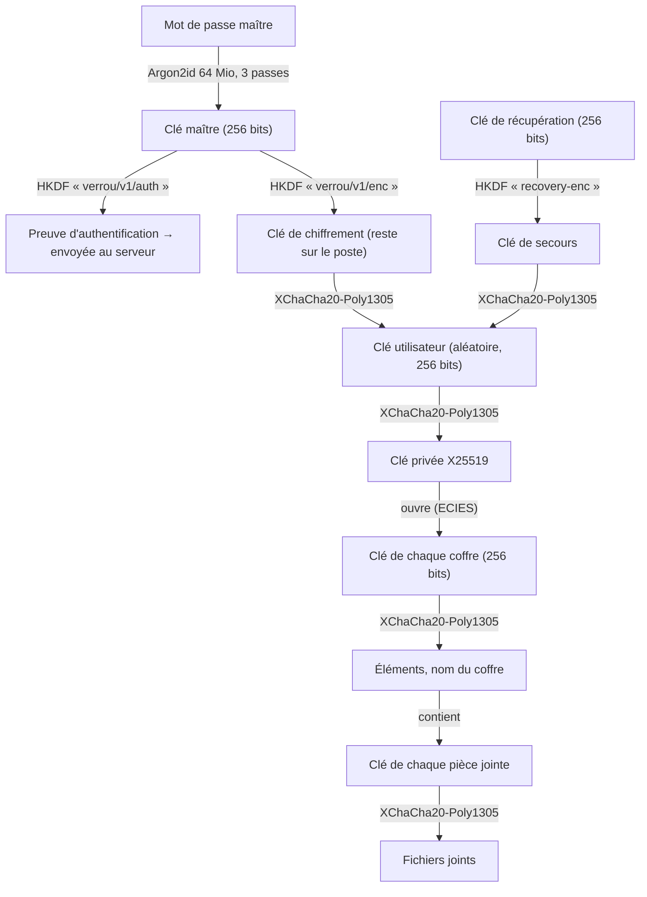

# Chiffrement et modèle de sécurité

Locksy applique un **chiffrement de bout en bout** (« zero-knowledge ») : les mots de passe, notes,
pièces jointes et noms de coffres sont chiffrés et déchiffrés **sur le poste de l'utilisateur**.
Le serveur ne stocke que des données chiffrées, des empreintes Argon2id et des métadonnées
(dates, rôles, appartenance aux coffres).

Le même noyau Rust (`crates/locksy-core`) est utilisé partout :

| Client | Exécution du noyau |
|---|---|
| Interface web | compilé en **WebAssembly** (`locksy.wasm`) |
| Extension Edge / Chrome | même module WebAssembly |
| Client Windows | compilé nativement dans `locksy.exe` |
| Serveur | vérifications de format, TOTP, hachage des preuves (jamais de déchiffrement des coffres) |

Bibliothèques : RustCrypto (`argon2`, `chacha20poly1305`, `hkdf`, `sha2`, `hmac`) et
`x25519-dalek`. Aucun code `unsafe` dans le noyau.

---

## 1. Primitives

| Usage | Algorithme | Paramètres |
|---|---|---|
| Mot de passe maître → clé | **Argon2id** (v1.3) | 64 Mio, 3 passes, 1 voie, sel aléatoire de 128 bits, sortie 256 bits |
| Séparation des clés | **HKDF-SHA256** | sel fixe de domaine, libellés distincts par usage |
| Chiffrement symétrique | **XChaCha20-Poly1305** (AEAD) | clé 256 bits, nonce aléatoire **192 bits**, données associées obligatoires |
| Échange de clés | **X25519** | clé éphémère par scellement, contrôle « contributory » |
| Preuve côté serveur | Argon2id | 19 Mio, 2 passes (sur une preuve déjà issue d'Argon2id) |
| Double authentification | TOTP RFC 6238 | HMAC-SHA1, 6 chiffres, 30 s, ±1 pas, rejeu interdit |
| Jetons (sessions, invitations, liens) | aléa système | 256 bits, stockés **hachés** (SHA-256) |
| Empreinte de clé publique | SHA-256 | 96 premiers bits, en groupes hexadécimaux |

Le mot de passe maître est normalisé en **Unicode NFC** avant dérivation : le même mot de passe
tapé sur Windows, macOS ou un téléphone donne toujours la même clé.

Paramètres Argon2id stockés avec chaque compte : ils pourront être renforcés plus tard sans
casser les comptes existants. Le serveur refuse des paramètres trop faibles (mémoire < 19 Mio,
moins de 2 passes, sel < 128 bits).

## 2. Hiérarchie des clés

Conséquences :
- **Changer de mot de passe maître** ne rechiffre que la clé utilisateur : c'est instantané.
- La **preuve d'authentification** ne permet de rien déchiffrer : elle est issue de la clé
  maître par une branche HKDF séparée, et le serveur la hache encore avec Argon2id.
- Un coffre partagé a **sa propre clé**, scellée séparément pour chaque membre.

## 3. Format des données chiffrées

| Préfixe | Contenu (base64url sans remplissage) |
|---|---|
| `v1.` | `nonce (24 o) ‖ chiffré ‖ étiquette Poly1305 (16 o)` |
| `s1.` | `clé publique éphémère (32 o) ‖ nonce (24 o) ‖ chiffré ‖ étiquette (16 o)` |

### Données associées (liaison au contexte)

Chaque chiffré est lié à **sa place** par ses données associées. Un serveur malveillant ne
peut pas déplacer un élément dans un autre coffre, échanger deux éléments, ni présenter la clé
d'un coffre à un autre membre : le déchiffrement échouerait.

| Donnée | Données associées |
|---|---|
| Clé utilisateur (mot de passe) | `verrou:v1:user-key` |
| Clé utilisateur (récupération) | `verrou:v1:recovery-user-key` |
| Clé privée | `verrou:v1:private-key:{utilisateur}` |
| Nom d'un coffre | `verrou:v1:collection-name:{coffre}` |
| Élément | `verrou:v1:item:{coffre}:{élément}` |
| Clé de coffre scellée | `verrou:v1:collection-key:{coffre}:{membre}` |
| Pièce jointe | `verrou:v1:attachment:{pièce}` |
| Lien de partage | `verrou:v1:share` |
| Sauvegarde chiffrée | `verrou:v1:export` |

> **Pourquoi « verrou » ?** Ces chaînes sont des **identifiants de protocole**, fixés lors de la
> première version (nom de code du projet). Les changer rendrait illisibles tous les coffres
> existants ; elles restent donc identiques, comme les libellés HKDF `verrou/v1/…`.

### Scellement d'une clé de coffre (ECIES)

1. Génération d'une paire X25519 éphémère.
2. Secret partagé avec la clé publique du destinataire ; refus si le secret n'est pas
   « contributory » (clé publique faible).
3. `HKDF-SHA256(sel = clé_éphémère ‖ clé_destinataire, info = "verrou/v1/seal|" + contexte)`.
4. XChaCha20-Poly1305 avec le contexte comme données associées.

## 4. Les parcours

### Création de compte
1. Le navigateur tire un sel, dérive la clé maître (Argon2id), puis la preuve et la clé de
   chiffrement.
2. Il génère la clé utilisateur, la clé de récupération, la paire X25519, le coffre personnel
   et sa clé.
3. Il envoie : la preuve, les clés chiffrées, la clé publique, le coffre personnel chiffré.
4. Le serveur hache la preuve (Argon2id) et enregistre le tout. Il n'a jamais vu le mot de
   passe, ni la clé utilisateur, ni la clé de récupération.

### Connexion
1. `prelogin` : le serveur renvoie les paramètres Argon2id du compte. Pour une adresse
   inconnue, il renvoie des paramètres **factices mais stables** (sel = HMAC-SHA256 avec la clé
   du serveur), pour qu'on ne puisse pas deviner quels comptes existent.
2. Le poste dérive la preuve et l'envoie. Le serveur la vérifie (temps constant, empreinte
   factice pour les comptes inexistants) et, si besoin, demande le code TOTP.
3. Le serveur renvoie la clé utilisateur chiffrée. Le poste la déchiffre localement, puis la clé
   privée. Il vérifie que la clé publique annoncée par le serveur correspond à sa clé privée.

### Partage d'un coffre
Le gestionnaire scelle la clé du coffre avec la clé publique du nouveau membre. L'interface
affiche l'**empreinte** de cette clé publique, à comparer de vive voix pour un partage sensible
(protection contre un serveur qui substituerait une clé).

### Retrait d'un membre
Le gestionnaire génère une **nouvelle clé de coffre**, rechiffre le nom et **tous** les
éléments (corbeille comprise), et la scelle pour les membres restants. Le serveur applique tout
en une transaction et refuse si la liste des membres ou des éléments ne correspond pas
exactement. Une copie de l'ancienne clé ne sert plus à rien. Les pièces jointes ne sont pas
rechiffrées : leurs clés sont dans les éléments, rechiffrés, et le serveur n'en sert le contenu
qu'aux membres actuels.

### Pièces jointes
Chaque fichier est chiffré avec une **clé aléatoire propre**, rangée dans l'élément chiffré
(avec le nom et le type du fichier). Le serveur ne voit qu'un bloc chiffré et sa taille.

### Liens de partage externes
Le contenu choisi est chiffré avec une clé aléatoire placée **après le `#`** du lien : les
navigateurs ne l'envoient jamais au serveur. Le serveur limite la durée de vie et le nombre de
consultations, puis détruit le lien. La page publique demande un clic avant d'afficher le
secret (les aperçus automatiques des messageries ne consomment pas de consultation).

### Clé de récupération
256 bits + un octet de contrôle (premier octet de SHA-256), en base32 Crockford par groupes de
4 caractères ; les confusions O/0 et I/L/1 sont corrigées. Elle chiffre une copie de la clé
utilisateur et permet de choisir un nouveau mot de passe maître. Elle est régénérable.

### SSO et compte Windows
OpenID Connect ou Active Directory **prouvent l'identité** et ouvrent une session ; ils ne
donnent **jamais** accès aux données. Le mot de passe maître reste indispensable. Un
fournisseur d'identité compromis permet d'ouvrir une session, pas de lire un coffre.

## 5. Côté serveur

- Secrets propres au serveur (`server.key`, 256 bits) : chiffrement au repos des secrets TOTP,
  du secret client SSO et du mot de passe du compte de service AD ; sels factices.
- Limitation des tentatives : blocage progressif après 5 échecs par compte et 20 par adresse
  IP (30 s, puis doublement jusqu'à 1 h) ; plafonds sur les routes publiques.
- Sessions : expiration après inactivité et durée maximale (réglables) ; désactiver un compte
  supprime immédiatement toutes ses sessions.
- Concurrence : chaque modification indique la révision lue ; une version périmée est refusée.
- En-têtes : CSP stricte (aucun script en ligne, `wasm-unsafe-eval` seulement),
  `frame-ancestors 'none'`, `nosniff`, `no-referrer`, `no-store` sur l'API, HSTS côté proxy.
- Stockage SQLite en `secure_delete` ; service sans privilèges (utilisateur dédié, systemd
  durci ou conteneur en lecture seule sans capacités).

## 6. Côté poste

- Les clés vivent dans la mémoire **WebAssembly** ; JavaScript ne manipule que des numéros de
  poignée. Le verrouillage efface tout le trousseau.
- Effacement des tampons sensibles (`zeroize`) dans le noyau et le client Windows.
- Verrouillage automatique après inactivité ; effacement du presse-papiers (30 s par défaut).
- Extension : les clés déverrouillées sont gardées dans `storage.session` (mémoire du
  navigateur, jamais sur disque), effacées après 15 minutes d'inactivité.
- Remplissage : l'extension refuse de remplir un site qui ne correspond pas à l'adresse
  enregistrée sans un second clic explicite (protection contre l'hameçonnage).

## 7. Menaces et réponses

| Scénario | Effet |
|---|---|
| Vol de la base et des sauvegardes | Données chiffrées ; attaque hors ligne sur Argon2id (64 Mio) par compte |
| Administrateur malveillant | Gère les accès, **ne lit aucun secret** |
| Membre retiré qui a gardé une copie | Clé renouvelée : sa copie ne déchiffre rien de nouveau |
| Serveur qui déplace ou rejoue des données | Refusé par les données associées |
| Serveur qui substitue une clé publique | Détectable par l'empreinte affichée |
| Écoute réseau | HTTPS obligatoire hors du poste local |
| Force brute en ligne | Blocage progressif, 2FA |
| Faux site (hameçonnage) | L'extension refuse de remplir sans confirmation |

## 8. Limites connues

- Un serveur compromis peut **refuser, supprimer ou restaurer une ancienne version** des
  données : le chiffrement garantit la confidentialité et l'intégrité, pas la disponibilité.
- L'interface web est servie par le serveur : un serveur compromis pourrait servir un
  JavaScript modifié. Le client Windows n'a pas cette faiblesse.
- Les droits « lecteur » sont imposés par le serveur ; un lecteur possède la clé du coffre.
- Le mot de passe Windows transite par le serveur (en HTTPS) pour être vérifié auprès de l'AD.
- Pas encore d'audit de sécurité externe.
