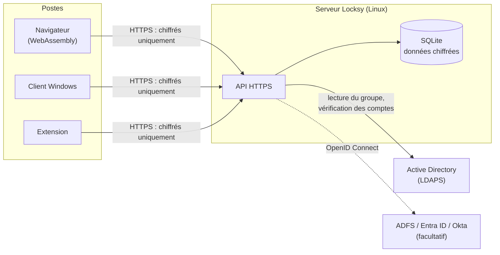

# Documentation de Locksy

Gestionnaire de mots de passe d'entreprise, **chiffré de bout en bout** et **hébergé chez
vous** : serveur Rust, interface web, client Windows, extension Edge/Chrome, intégration
Active Directory sur site, SSO OpenID Connect et SCIM.

## Par où commencer

| Je veux… | Page |
|---|---|
| Utiliser mon coffre au quotidien | [Guide utilisateur](Guide-utilisateur.md) |
| Administrer l'organisation | [Guide administrateur](Administration.md) |
| Connaître chaque réglage, ses bornes et sa valeur par défaut | [Réglages de l'organisation](Reglages.md) |
| Installer le serveur (VM Linux ou Docker) | [Installation du serveur](Installation-du-serveur.md) |
| Brancher l'Active Directory, sans cloud | [Déploiement avec Active Directory](Deploiement-Active-Directory.md) |
| Comprendre le chiffrement | [Chiffrement et sécurité](Chiffrement-et-securite.md) |
| Connaître le modèle de sécurité et ses limites | [SECURITE.md](../SECURITE.md) |
| Signaler une vulnérabilité, vérifier une version | [SECURITY.md](../SECURITY.md) |
| Découvrir les fonctionnalités | [Fonctionnalités](Fonctionnalites.md) |
| Équiper les postes (GPO, Intune) | [Extension navigateur](Extension-navigateur.md#déploiement-sur-les-postes) · [Client Windows](Client-Windows.md) (refonte en 1.2) |
| Brancher Microsoft Entra, Google, Okta, ADFS, SCIM | [SSO et SCIM](SSO-et-SCIM.md) |
| Sauvegarder, mettre à jour, revenir en arrière | [Sauvegarde et mises à jour](Sauvegarde-et-mises-a-jour.md) |
| Exploiter au quotidien, réagir à un incident | [Exploitation](Exploitation.md) |
| Préparer la reprise après sinistre | [PRA/PCA](PRA-PCA.md) |
| Remplir le registre RGPD | [RGPD](RGPD.md) |
| Savoir ce qui change d'une version à l'autre | [Journal des modifications](../CHANGELOG.md) |
| Intégrer Locksy à un autre outil | [API](API.md) |
| Compiler, contribuer | [Développement](Developpement.md) |
| Questions fréquentes | [FAQ](FAQ.md) |

## En bref

- **Rien en clair sur le serveur** : Argon2id, XChaCha20-Poly1305, X25519, HKDF ; même noyau
  Rust dans le navigateur (WebAssembly), le client Windows et le serveur.
- **Coffres partagés** avec droits, renouvellement de clé au retrait d'un membre ; **liens
  sécurisés** pour une personne sans Locksy.
- **Tout se règle depuis l'administration** : un registre unique de réglages, des profils de
  sécurité, une politique diffusée à l'interface web et à l'extension.
- **Active Directory** : synchronisation d'un groupe, connexion avec le compte Windows, coupure
  immédiate des comptes désactivés.
- **Administration sans accès aux secrets**, journal chaîné et vérifiable, envoi Syslog,
  e-mails et notifications.
- **Client Windows** : la version 1.1 garde son interface et sa politique locale ; sa refonte
  arrive en 1.2.
- Licence **MIT**.

## Architecture

