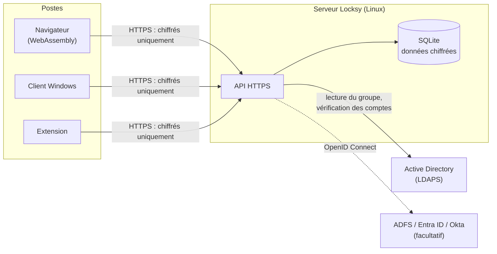

# Locksy

Gestionnaire de mots de passe d'entreprise, **chiffré de bout en bout** et **hébergé chez
vous** : serveur Rust, interface web, client Windows, extension Edge/Chrome, intégration
Active Directory sur site, SSO OpenID Connect et SCIM.

## Par où commencer

| Je veux… | Page |
|---|---|
| Installer le serveur (VM Linux ou Docker) | [Installation du serveur](Installation-du-serveur) |
| Brancher l'Active Directory, sans cloud | [Déploiement avec Active Directory](Deploiement-Active-Directory) |
| Comprendre le chiffrement | [Chiffrement et sécurité](Chiffrement-et-securite) |
| Découvrir les fonctionnalités | [Fonctionnalités](Fonctionnalites) |
| Administrer l'organisation | [Administration](Administration) |
| Équiper les postes | [Client Windows](Client-Windows) · [Extension navigateur](Extension-navigateur) |
| Utiliser Entra ID, Okta, ADFS, SCIM | [SSO et SCIM](SSO-et-SCIM) |
| Sauvegarder, mettre à jour | [Sauvegarde et mises à jour](Sauvegarde-et-mises-a-jour) |
| Intégrer Locksy à un autre outil | [API](API) |
| Compiler, contribuer | [Développement](Developpement) |
| Questions fréquentes | [FAQ](FAQ) |

## En bref

- **Rien en clair sur le serveur** : Argon2id, XChaCha20-Poly1305, X25519, HKDF ; même noyau
  Rust dans le navigateur (WebAssembly), le client Windows et le serveur.
- **Coffres partagés** avec rôles, renouvellement de clé au retrait d'un membre.
- **Active Directory** : synchronisation d'un groupe, connexion avec le compte Windows, coupure
  immédiate des comptes désactivés.
- **Administration sans accès aux secrets**, journal d'audit complet, envoi Syslog.
- Licence **MIT**.

## Architecture

